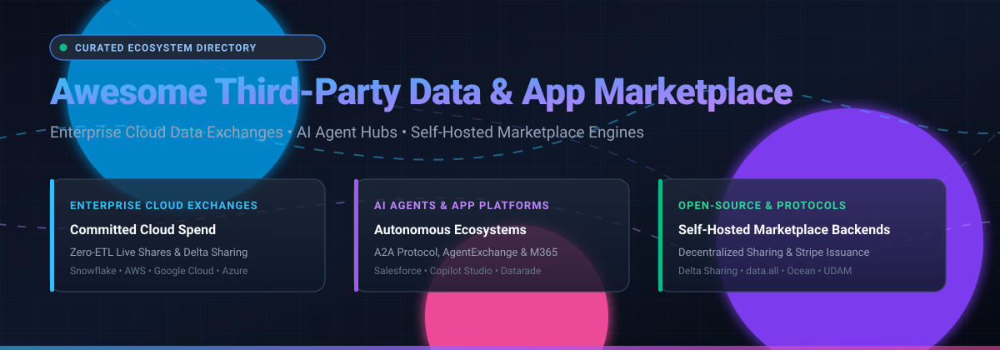

  

# Awesome Third-Party Data & App Marketplace

A curated list of **Enterprise Third-Party Data Marketplaces**, **Cloud Data Exchanges**, **SaaS App Marketplaces**, and **Open-Source Marketplace Infrastructure**.

> Discover platforms, protocols, and self-hosted backends powering the global data economy, cloud procurement drawdown, zero-ETL data sharing, and AI agent distribution.

---

## Table of Contents

- [Sector Overview & Market Dynamics](#sector-overview--market-dynamics)
- [SaaS & Hosted Marketplaces](#saashosted-platforms)
- [Open-Source Marketplace Projects](#open-source-github-projects)
- [Architectural Key Differences](#architectural-key-differences)
- [How to Contribute](#how-to-contribute)
- [Disclaimer & Licensing](#disclaimer)

---

## Sector Overview & Market Dynamics

The global third-party data and commercial cloud marketplace sector is estimated at **$28.5 Billion in 2026** and projected to exceed **$85 Billion by 2030**, driven exponentially by enterprise AI training ingestion, autonomous agent distribution, and committed cloud budget drawdowns. The sector is **highly concentrated and winner-take-most**, where hyperscalers (AWS, Microsoft Azure, Google Cloud) and modern cloud data warehouses (Snowflake, Databricks) leverage distribution moats, runtime execution lock-in, and pre-allocated enterprise cloud budgets that standalone catalog vendors cannot easily disrupt.

---

## SaaS/Hosted Platforms

The table below profiles the leading hosted third-party data and application marketplaces, sorted in descending order by parent company scale (valuation / market capitalization).

| Marketplace | Parent Company Scale (Market Cap / Valuation) | Starting Pricing (Specific Tier) | Free Tier Limits / Free Trial Policy | Key Focus & Capabilities |
| :--- | :--- | :--- | :--- | :--- |
| **[Microsoft Commercial Marketplace](https://azuremarketplace.microsoft.com/)** | **$3,150 Billion** (Market Cap) | **$0 listing fee**; charges **3% flat transaction fee** for transactable listings; SaaS app listings start at **$0.01/hour** or **$5/user/month** minimum | **$200 Azure cloud credit** for 30 days plus 55+ always-free services; free trial SaaS listings supported up to **30 or 90 days** per publisher | Azure Marketplace & M365 Agent Store reaching 400M+ enterprise seats across Teams, Outlook, and Copilot Studio. |
| **[Google Cloud Marketplace](https://cloud.google.com/marketplace)** | **$2,180 Billion** (Market Cap) | **$0 listing fee**; **3% platform transaction fee**; VM/Container listings start at **$0.01/core-hour**; dataset subscriptions from **$20/month** | **$300 free credits** over a 90-day free trial period for new Google Cloud users, plus 20+ always-free products | Protocol-first AI distribution via Agent2Agent (A2A) protocol, Gemini Enterprise ecosystem, and Vertex AI integrations. |
| **[AWS Marketplace](https://aws.amazon.com/marketplace)** | **$2,020 Billion** (Market Cap) | **$0 listing fee**; sellers pay tiered **1.5% to 3.0% transaction fee** (or 30% for AWS Data Exchange); listings start at **$0.01/unit** or **$25/month** base | **AWS Free Tier (12-month tier, always-free services)**; marketplace data listings offer **30-day free trials** with custom sample record limits | The largest cloud catalog with 3,500+ commercial data feeds, file deliveries to S3/Redshift, and cloud budget burn-down. |
| **[Salesforce AppExchange](https://appexchange.salesforce.com/)** | **$280 Billion** (Market Cap) | **$2,700 first-year Partner Program onboarding fee** ($150 annual renewal); revenue share **15%** (ISVforce) or **25%** (OEM); app listings start at **$1/user/month** | **30-day free trial** of Salesforce Developer Edition; apps often offer **14-day or 30-day fully functional trial** orgs | Enterprise CRM and AgentExchange platform featuring 5,000+ business applications and 1,000+ autonomous AI agent skills. |
| **[Bloomberg Enterprise Access Point](https://www.bloomberg.com/professional/)** | **$125 Billion** (Valuation) | Minimum enterprise contract starts at **$15,000/year** (or terminal licensing starting from **$2,500/month** per seat) | **No perpetual free tier**; offers structured **14-day proof-of-concept (PoC) free trial** with restricted test datasets for qualified institutional firms | Institutional finance data portal delivering normalized equity, fixed income, reference data, and real-time feeds via SFTP/REST/Snowflake. |
| **[Snowflake Marketplace](https://www.snowflake.com/)** | **$55 Billion** (Market Cap) | **$0 listing fee**; data providers receive **90% revenue share** (10% platform fee); paid datasets start at **$100/month** flat subscription | **30-day free trial with $400 worth of free compute credits**; permanent **free listings/sample shares** accessible with 0 platform fees | Zero-ETL direct SQL live shares directly inside customer accounts without copying files or building ingest pipelines. |
| **[Databricks Marketplace](https://www.databricks.com/)** | **$43 Billion** (Valuation) | **$0 marketplace fee** for Delta Sharing consumers; seller payout **90%** on paid datasets; paid data listings start from **$150/month** | **14-day full platform free trial** on AWS/Azure/GCP; permanent access to **1,200+ free open-access public datasets** via Delta Sharing | Cross-cloud and multi-engine lakehouse data exchange, featuring Delta Sharing tables, ML models, and LLM notebooks. |
| **[FactSet Marketplace](https://www.factset.com/marketplace)** | **$17 Billion** (Market Cap) | Single API package feeds start at **$1,000/month** minimum baseline contract | **No perpetual free tier**; provides a **30-day corporate sandbox trial** with historical mock financial datasets upon sales approval | Over 320 specialized financial, earnings, and ESG data products integrating with Snowflake, Redshift, and Databricks. |
| **[Crux Informatics](https://www.cruxinformatics.com/)** | **$350 Million** (Valuation) | Managed data pipelines and distribution starting from **$2,500/month** | **No perpetual free tier**; provides a **30-day sandbox pilot** with up to 3 supplier data pipelines for enterprise evaluation | Data pipeline delivery and data operations platform standardizing ingestion from external suppliers into enterprise warehouses. |
| **[Datarade](https://datarade.ai/)** | **$25 Million** (Valuation) | **$0 for data buyers**; vendor lead-generation listings start at **€600/month** (Annual Partner Tier) | **Perpetual 100% free search & directory browsing for buyers**; free trial data samples available on demand per vendor | Neutral data marketplace search engine and RFQ directory connecting enterprise buyers with 550+ global data vendors. |

---

## Open-Source GitHub Projects

Open-source repositories providing core marketplace components, decentralized data sharing protocols, self-hosted web directories, and billing engines. Ranked by GitHub stars in descending order:

| Project & Repository | Stars Badge | Architecture / Tech Stack | Primary Capabilities & Role |
| :--- | :--- | :--- | :--- |
| **[Delta Sharing](https://github.com/delta-io/delta-sharing)** |  | Python, Rust, Scala, Spark | **Open Data Exchange Protocol**: The open protocol developed by Databricks for secure real-time data sharing across clouds and compute systems without data replication or proprietary warehouse lock-in. |
| **[data.all](https://github.com/data-dot-all/dataall)** |  | Python, React, GraphQL, AWS CDK | **Enterprise Internal Data Marketplace**: An open-source framework developed by AWS to build custom enterprise data marketplaces, automating data governance, cross-account sharing, and catalog discovery. |
| **[Ocean Protocol Market](https://github.com/oceanprotocol/market)** |  | React, TypeScript, Next.js, Web3 | **Decentralized Data Marketplace Frontend**: Production-ready open-source frontend client for monetizing, discovering, and transacting data assets, algorithms, and compute-to-data jobs using blockchain tokens. |
| **[Google Cloud Datashare Toolkit](https://github.com/GoogleCloudPlatform/datashare-toolkit)** |  | Python, Terraform, BigQuery | **Self-Hosted Commercial Data Sharing Engine**: Reference architecture and tools from Google Cloud for publishers to build commercial data delivery pipelines and monetize datasets via BigQuery and Cloud Storage. |
| **[World Vibe Web (WVW)](https://github.com/f/wvw.dev)** |  | Static Site, JavaScript, GitHub Actions | **Federated Open-Source App Directory**: Decentralized app directory demonstrating community listing aggregation where developers publish `apps.json` metadata in their own GitHub repos without a central listing authority. |
| **[Unified Data Marketplace (UDAM)](https://github.com/data-agent-marketplace/data-agent-marketplace)** |  | Node.js, Next.js, PostgreSQL, Stripe | **Transactional Data Marketplace Backend**: Complete API-first backend for monetizing data services, featuring Stripe billing integration, AES-256 token encryption, and concurrency-safe PostgreSQL row locking. |
| **[FQora](https://github.com/Songyue-Guo/FQora_web_demo)** |  | Python, Flask, Academic Demo | **Algorithmic Quality-Pricing Prototype**: Research implementation of fair and quality-based data pricing functions (ACM Web Conference), showcasing Balanced Pareto Optimization between buyers and sellers. |

---

## Architectural Key Differences

When evaluating third-party data and app marketplace solutions, note three fundamental deployment patterns:

1. **Procurement & Cloud Spend Integration (Hyperscalers)**:
   - AWS Marketplace, Microsoft Azure Marketplace, and Google Cloud Marketplace allow buyers to retire existing enterprise committed cloud expenditure (EDP, MACC).
   - This procurement friction-reducer is a contractual and billing capability that standalone open-source software cannot reproduce out of the box.

2. **Zero-ETL Live Sharing (Modern Data Warehouses)**:
   - Snowflake Marketplace and Databricks Marketplace (via Delta Sharing) expose live database tables directly inside the consumer's analytics engine.
   - Eliminates data movement, batch ETL pipelines, and storage duplications.

3. **Self-Hosted & API-Driven Marketplaces (Open-Source)**:
   - Use **[UDAM](https://github.com/data-agent-marketplace/data-agent-marketplace)** for self-hosted REST API key sales and Stripe checkout flows.
   - Use **[data.all](https://github.com/data-dot-all/dataall)** for enterprise-internal governed dataset distribution.
   - Use **[Delta Sharing](https://github.com/delta-io/delta-sharing)** for cross-platform zero-copy data exchange over open REST protocols.

---

## How to Contribute

Contributions are welcome to expand and refine this ecosystem directory!

1. **Fork the repository** on GitHub.
2. **Add or update an entry** in `README.md`:
   - For SaaS products: provide precise parent scale (valuation / market cap), starting price tier, free tier / trial rules, and core features.
   - For Open-Source projects: provide the GitHub repo link, verify star counts, and include its architecture and role.
3. **Submit a pull request** with a concise description of the addition.

---

## Disclaimer

- This list is community-curated for informational and architectural evaluation purposes.
- Data and application listings are subject to external licensing agreements, copyright, privacy frameworks (GDPR, CCPA/CPRA, HIPAA), and proprietary terms of service. Review third-party warranty and sublicensing provisions before subscribing.
- All product names, logos, and brands belong to their respective copyright holders.

---

  Maintained for data platform architects, procurement leaders, and software engineers building data marketplace infrastructure.

